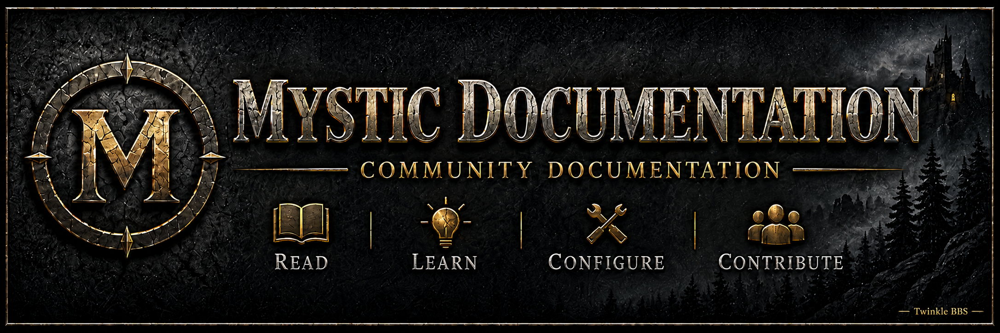

<p align="center">
  
</p>

<h1 align="center">Mystic Documentation</h1>

<p align="center">
  Community-maintained documentation for installing, configuring, operating, networking, troubleshooting, and extending Mystic BBS.
</p>

> **Mystic BBS was created by James Coyle.**  
> This repository is an independent community documentation project and is not an official Mystic BBS publication.

## Start Here

| Goal | Documentation |
|---|---|
| New or returning SysOp | [Getting Started](wiki/Getting-Started.md) |
| Understand Mystic and its components | [What Is Mystic BBS?](wiki/What-Is-Mystic-BBS.md) |
| Install a new system | [Installing Mystic](wiki/Installing-Mystic.md) |
| Learn the configuration system | [Mystic Configuration System](wiki/Mystic-Configuration-System.md) |
| Begin FTN networking | [FTN Networking](wiki/FTN-Networking.md) |
| Review project coverage | [Documentation Status](wiki/Documentation-Status.md) |

## Current Documentation

### Phase 1: Foundation

The first foundation pass is complete and currently marked **Draft / Needs verification** while procedures are reproduced against named Mystic releases and platforms.

- [Getting Started](wiki/Getting-Started.md)
- [What Is Mystic BBS?](wiki/What-Is-Mystic-BBS.md)
- [Installing Mystic](wiki/Installing-Mystic.md)
- [Creating the First SysOp Account](wiki/First-Sysop-Account.md)
- [Mystic Directory Structure](wiki/Mystic-Directory-Structure.md)
- [Mystic Configuration System](wiki/Mystic-Configuration-System.md)
- [Starting Mystic](wiki/Starting-Mystic.md)
- [Backup and Upgrade](wiki/Backup-and-Upgrade.md)

### FTN Networking

The FTN section currently establishes the core concepts and mail-flow model before moving into transport and automation topics.

- [FTN Networking Overview](wiki/FTN-Networking.md)
- [FTN Addressing](wiki/FTN-Addressing.md)
- [Echomail and Netmail](wiki/Echomail-and-Netmail.md)
- [Mystic FTN Mail Flow](wiki/Mystic-FTN-Mail-Flow.md)

Planned FTN coverage includes EchoMail Nodes, BinkP, MUTIL mail processing, MIS POLL, AreaFix, FileFix, TIC/file echoes, routing, nodelists, and troubleshooting. Legacy FIDOPOLL behavior will be documented only where it is useful for historical or upgrade reference.

## Project Scope

The long-term goal is a practical Mystic BBS reference covering:

- Installation and upgrades
- System configuration
- Users, security levels, and ACS
- Message groups and message bases
- File groups and file bases
- Menus, prompts, themes, and display files
- MIS and network services
- FTN echomail, netmail, BinkP, MUTIL, and polling
- AreaFix, FileFix, TIC processing, and file echoes
- Events, semaphores, logging, backups, and maintenance
- Troubleshooting and recovery
- Development integration and links to dedicated scripting documentation

## Documentation Standards

This project is intended to be useful at the console, not merely descriptive. Documentation should therefore be:

- **Practical** — focused on real SysOp tasks and operational workflows
- **Structured** — explaining how Mystic components fit together before presenting isolated settings
- **Version-aware** — clearly identifying behavior that differs between Mystic releases or platforms
- **Testable** — including verification steps wherever a procedure changes or starts something
- **Transparent** — distinguishing drafts, unverified procedures, and confirmed behavior
- **Original** — written as independent community documentation rather than copied third-party material

## Verification Policy

Documentation uses the following broad status levels:

| Status | Meaning |
|---|---|
| **Planned** | The page or section has been identified but not written |
| **Draft** | Initial documentation exists and needs review or expansion |
| **Needs verification** | The documented behavior should be reproduced against a named Mystic version and platform |
| **Verified** | The procedure or behavior has been tested and the environment is recorded |
| **Version-specific** | The behavior is confirmed only for a named Mystic release or platform |

A procedure is not considered verified simply because the configuration appears correct. Verification should include the expected runtime result.

See [Documentation Status](wiki/Documentation-Status.md) for current coverage.

## MPL and MPY Development

Detailed Mystic Programming Language documentation is maintained separately in:

- [Pequito/mystic-mpl-docs](https://github.com/Pequito/mystic-mpl-docs)

This repository may document how scripting integrates with Mystic features, but language-level MPL and MPY documentation should remain in the dedicated programming documentation project rather than being duplicated here.

## Repository Layout

```text
mystic-documentation/
├── assets/
│   └── wiki/          # Documentation artwork and wiki assets
├── wiki/              # Wiki-style Markdown documentation
├── CONTRIBUTING.md    # Contribution guidelines
├── LICENSE             # Documentation license
└── README.md           # Project overview
```

The wiki source includes custom navigation through [`wiki/_Sidebar.md`](wiki/_Sidebar.md) and shared footer content through [`wiki/_Footer.md`](wiki/_Footer.md).

## Contributing

Corrections, tested procedures, screenshots, diagrams, platform notes, version notes, and additional Mystic documentation are welcome.

Before contributing, review [CONTRIBUTING.md](CONTRIBUTING.md). When documenting version-sensitive behavior, include the Mystic version and operating system used for testing whenever possible.

## About Mystic BBS

Mystic BBS was created by **James Coyle**. This project documents his software from a community and SysOp perspective while remaining independent of the official Mystic BBS project.

Mystic BBS software, names, and associated trademarks remain the property of their respective rights holders.

## License

Documentation in this repository is provided under the [MIT License](LICENSE).
